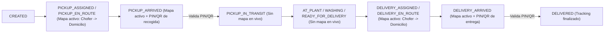
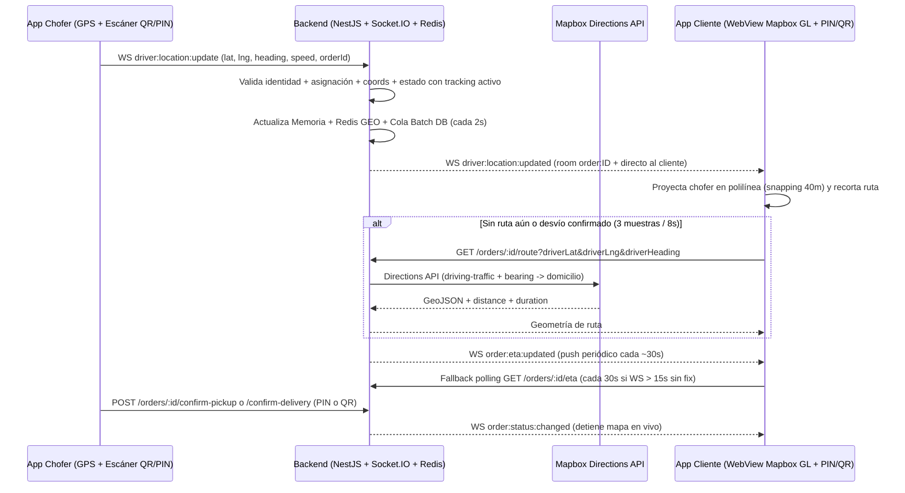

# Plan de Implementación: Seguimiento de Chofer en Tiempo Real para Lavandería a Domicilio

Este plan adapta la arquitectura probada en producción de **AnubisRide** (`NestJS + Prisma + Redis + Expo/React Native + Mapbox GL JS en WebView`) al flujo de **lavandería a domicilio**, cubriendo de extremo a extremo los **dos momentos de seguimiento hacia el domicilio del cliente**:

1. **Tramo 1 — Recogida (`PICKUP`):** El cliente ve al chofer en el mapa en tiempo real mientras se dirige a su domicilio para retirar las prendas. Al confirmar el retiro mediante **PIN o QR**, el seguimiento en vivo se detiene.
2. **Tramo 2 — Entrega (`DELIVERY`):** Cuando las prendas salen de planta listas, el cliente vuelve a ver al chofer en tiempo real mientras se dirige a su domicilio. Al confirmar la entrega mediante **PIN o QR**, la orden finaliza y el seguimiento se detiene.

> [!NOTE]
> **Regla de visibilidad definida:** El cliente **no** ve el mapa en vivo durante `PICKUP_IN_TRANSIT` (traslado hacia la planta) ni durante el lavado (`AT_PLANT` / `WASHING`). El destino del mapa en vivo para el cliente es **siempre su domicilio**, tanto en recogida como en entrega.

---

## 1. Arquitectura General y Flujo de Estados

### 1.1 Máquina de estados de la orden (2 ventanas de tracking activo)



### 1.2 Flujo de datos en tiempo real



---

## 2. Fase 1 — Infraestructura, Entorno y Modelo de Datos

### 2.1 Variables de entorno requeridas

**Backend (`.env`):**
```env
DATABASE_URL=postgresql://...
REDIS_URL=redis://...
JWT_SECRET=...
SOCKET_CORS_ORIGIN=https://tu-dominio-admin.com,exp://...
MAPBOX_ACCESS_TOKEN=pk.eyJ...
```

**App Cliente y App Chofer (`eas.json` / `.env`):**
```env
EXPO_PUBLIC_API_URL=https://api.tu-lavanderia.com/api/v1
EXPO_PUBLIC_SOCKET_URL=https://api.tu-lavanderia.com
EXPO_PUBLIC_MAPBOX_ACCESS_TOKEN=pk.eyJ...
```

> [!IMPORTANT]
> Nunca hardcodear el token de Mapbox en el código fuente. Usar `process.env.EXPO_PUBLIC_MAPBOX_ACCESS_TOKEN` en móvil (solo tiles/renderizado) y `MAPBOX_ACCESS_TOKEN` en backend (Directions API / ETA).

### 2.2 Modelo de datos (Prisma)

Soportando dos choferes independientes (recogida y entrega) y códigos de verificación en puerta (PIN + QR):

```prisma
enum OrderStatus {
  CREATED
  PICKUP_ASSIGNED
  PICKUP_EN_ROUTE
  PICKUP_ARRIVED
  PICKUP_IN_TRANSIT
  AT_PLANT
  WASHING
  READY_FOR_DELIVERY
  DELIVERY_ASSIGNED
  DELIVERY_EN_ROUTE
  DELIVERY_ARRIVED
  DELIVERED
  CANCELLED
}

model Order {
  id                String      @id @default(cuid())
  customerId        String
  pickupDriverId    String?
  deliveryDriverId  String?
  status            OrderStatus @default(CREATED)

  // Coordenadas del domicilio del cliente (destino en ambos tramos de tracking)
  customerLat       Float
  customerLng       Float
  customerAddress   String

  // Coordenadas de la planta de lavandería (solo referencia operativa/chofer)
  plantLat          Float
  plantLng          Float
  plantAddress      String

  // Verificación en puerta (PIN de 4-6 dígitos + token QR firmado o derivado)
  pickupCode        String?
  pickupQrToken     String?     @unique
  pickupConfirmedAt DateTime?

  deliveryCode        String?
  deliveryQrToken     String?   @unique
  deliveryConfirmedAt DateTime?

  locationPings     OrderLocationPing[]
  createdAt         DateTime    @default(now())
  updatedAt         DateTime    @updatedAt
}

model Driver {
  id                String    @id @default(cuid())
  userId            String    @unique
  status            String    @default("OFFLINE") // ONLINE, BUSY, OFFLINE
  currentLat        Float?
  currentLng        Float?
  locationUpdatedAt DateTime?
}

model OrderLocationPing {
  id        String   @id @default(cuid())
  orderId   String
  leg       String   // "PICKUP" | "DELIVERY"
  lat       Float
  lng       Float
  createdAt DateTime @default(now())
  order     Order    @relation(fields: [orderId], references: [id], onDelete: Cascade)
  @@index([orderId, createdAt])
}
```

---

## 3. Fase 2 — Backend (NestJS: WebSockets, Mapbox, ETA y PIN/QR)

### 3.1 Estados con tracking visible para el cliente

Definir una constante compartida en backend:
```ts
export const CUSTOMER_LIVE_TRACKING_STATUSES: OrderStatus[] = [
  OrderStatus.PICKUP_ASSIGNED,
  OrderStatus.PICKUP_EN_ROUTE,
  OrderStatus.PICKUP_ARRIVED,
  OrderStatus.DELIVERY_ASSIGNED,
  OrderStatus.DELIVERY_EN_ROUTE,
  OrderStatus.DELIVERY_ARRIVED,
];
```

### 3.2 `SocketGateway` (Basado en `uber-backend/src/modules/socket/infrastructure/socket.gateway.ts`)

1. **Configuración del Gateway:**
   * `transports: ['websocket', 'polling']`, `pingInterval: 25000`, `pingTimeout: 20000`, `perMessageDeflate: { threshold: 256 }`.
2. **Autenticación en `handleConnection`:**
   * Validar JWT de `client.handshake.auth?.token`, verificar usuario activo en Prisma, registrar en `userSockets` y emitir `authenticated`.
3. **Suscripción `driver:location:update`:**
   * Payload: `{ driverId, lat, lng, heading?, speed?, orderId? }`.
   * **Validaciones:**
     * `assertDriverSocketIdentity(client, data.driverId)`
     * `validateDriverCoordinates(data.lat, data.lng)`
     * Si viene `orderId`, verificar que `driverId` corresponda a `pickupDriverId` (tramo recogida) o `deliveryDriverId` (tramo entrega).
   * **Actualización de estado:**
     * Memoria (`driverLocations`) + **Redis GEO** (`redisGeo.addDriverLocation`) + cola batch a PostgreSQL cada **2 s** (`processBatchLocationUpdates`).
   * **Retransmisión selectiva al cliente:**
     * **Solo** si `order.status` está en `CUSTOMER_LIVE_TRACKING_STATUSES`, emitir `driver:location:updated` a la sala `order:${orderId}` y directo a `emitToUser(customerId, 'driver:location:updated', { orderId, driverId, leg, location })`.
     * En `PICKUP_IN_TRANSIT`, la ubicación se sigue guardando para monitoreo interno/admin si se desea, pero **no se retransmite al cliente**.
4. **Eventos push al cliente:**
   * `order:status:changed` (`{ orderId, status, leg, updatedAt }`)
   * `order:driver_arrived` (`{ orderId, leg }`)
   * `order:eta:updated` (`{ orderId, leg, eta, distance, updatedAt }`)

### 3.3 Servicio de Mapbox Directions (`MapboxService`)

Portar directamente `uber-backend/src/modules/trips/infrastructure/services/mapbox.service.ts`:
* Endpoint: `https://api.mapbox.com/directions/v5/mapbox/driving-traffic/{lng1},{lat1};{lng2},{lat2}?geometries=geojson&overview=full`.
* Soporte de `originBearing` (`bearings=${originBearing},45;`) para evitar rutas con giros en U falsos.
* Caché en memoria de 5 min (coordenadas redondeadas a 4 decimales ≈ 11 m), timeout `5000 ms` y rate limit `<= 300 req/min`.

### 3.4 Endpoints de Ruta, ETA y Confirmación PIN/QR

1. **`GET /orders/:id/route?driverLat=&driverLng=&driverHeading=`**
   * Valida que el solicitante sea el `customerId` dueño de la orden (o el chofer asignado).
   * Si `order.status` **no** está en `CUSTOMER_LIVE_TRACKING_STATUSES`, responder `400 BadRequest` (`Tracking not active for current order status`).
   * Resuelve siempre:
     * `origin`: ubicación del chofer activo (`pickupDriverId` o `deliveryDriverId`).
     * `destination`: `{ latitude: order.customerLat, longitude: order.customerLng }`.
   * Retorna `{ success: true, data: { distance, duration, geometry } }`.

2. **`GET /orders/:id/eta`**
   * Calcula ETA con Mapbox hacia el domicilio del cliente y retorna `{ success: true, data: { eta, distance, leg, driverLocation: { lat, lng } } }`.

3. **`OrderEtaService` (Push cada 30 s):**
   * Inicia el intervalo cuando la orden entra a `PICKUP_ASSIGNED` o `DELIVERY_ASSIGNED`.
   * Emite `order:eta:updated` cada 30 s hacia el domicilio del cliente.
   * **Detiene el intervalo** inmediatamente al pasar a `PICKUP_IN_TRANSIT`, `DELIVERED` o `CANCELLED`.

4. **Confirmación en puerta por PIN o QR:**
   * Al asignar chofer de recogida (`PICKUP_ASSIGNED`): generar `pickupCode` (4 dígitos numéricos) y `pickupQrToken` (UUID/token firmado).
   * Al asignar chofer de entrega (`DELIVERY_ASSIGNED`): generar `deliveryCode` (4 dígitos) y `deliveryQrToken`.
   * Endpoints para el chofer:
     * `POST /orders/:id/confirm-pickup` con `{ code?: string; qrToken?: string }` → valida contra `pickupCode` o `pickupQrToken`, cambia estado a `PICKUP_IN_TRANSIT`, limpia/invalida `pickupCode`/`pickupQrToken`, detiene el intervalo de ETA y emite `order:status:changed`.
     * `POST /orders/:id/confirm-delivery` con `{ code?: string; qrToken?: string }` → valida contra `deliveryCode` o `deliveryQrToken`, cambia estado a `DELIVERED`, invalida códigos, detiene ETA y emite `order:status:changed`.

---

## 4. Fase 3 — App del Chofer (`laundry-driver`)

### 4.1 Hook de GPS filtrado (`useDriverLocationEmitter`)
Portar `uber-driver/src/presentation/hooks/useDriverLocationEmitter.ts`:
* `Location.watchPositionAsync` con `Accuracy.BestForNavigation`, `timeInterval: 1000`, `distanceInterval: 3`.
* Filtros anti-ruido: `MAX_ACCEPTABLE_ACCURACY_METERS = 25` (`80` si stale >15 s), `MAX_PLAUSIBLE_SPEED_MPS = 55` y ventana de recalibración inicial.
* Tarea en segundo plano (`expo-task-manager`) para mantener el envío si el chofer abre navegación externa (Waze/Google Maps).

### 4.2 Emisor WebSocket + Confirmación PIN/QR
* En `OrderProvider` del chofer:
  * Throttle con `shouldPushDriverLocation`.
  * Emitir `driver:location:update` por WebSocket con `orderId` (y fallback REST `PATCH /drivers/location` si el socket cae).
* Flujo de botones y escáner en puerta:
  * **Recogida:** *"En camino al domicilio"* → *"Llegué al domicilio"* → modal con **2 pestañas: Escanear QR (`expo-camera`) o Ingresar PIN de 4 dígitos** → llama a `POST /orders/:id/confirm-pickup`.
  * **Entrega:** *"Saliendo de planta"* → *"Llegué al domicilio"* → mismo modal **Escanear QR / Ingresar PIN** → llama a `POST /orders/:id/confirm-delivery`.

---

## 5. Fase 4 — App del Cliente (`laundry-user`)

### 5.1 Configuración de Mapbox y Componente de Mapa
Portar desde `uber-user`:
1. `src/config/mapbox.ts`: `EXPO_PUBLIC_MAPBOX_ACCESS_TOKEN` y `MAPBOX_STYLE` (`navigation-night-v1` o `navigation-day-v1`).
2. `src/presentation/components/maps/mapboxHtmlTemplate.ts`: **Mapbox GL JS v2.15.0** en `react-native-webview` con marcador del domicilio, marcador SVG del vehículo rotado por `bearing`, polilínea GeoJSON y `followDriver`.
3. `src/presentation/components/maps/mapBridgeTypes.ts` y `MapViewCustom.tsx` (memoizado con `areMapPropsEqual`).

### 5.2 WebSocket Cliente y Eventos de Orden
Portar `SocketService.ts` y crear `useCustomerOrderSocketEvents.ts`:
* Autenticación JWT con refresh automático y reconexión controlada.
* Al recibir `authenticated`, resincronizar `GET /orders/:id`.
* Escuchar `driver:location:updated` con buffer `pendingDriverLocationRef` para no perder fixes antes de alinear el estado.
* Al recibir `order:status:changed`:
  * Si entra a `PICKUP_IN_TRANSIT`, `AT_PLANT`, `WASHING`, `DELIVERED` o `CANCELLED`: limpiar `driverLocation` y `routeGeometry` y ocultar el mapa en vivo.
  * Si entra a `DELIVERY_ASSIGNED` / `DELIVERY_EN_ROUTE`: limpiar cualquier estado residual del tramo de recogida y activar el mapa en vivo para el nuevo chofer.

### 5.3 Snapping y Detección de Desvíos
Portar directo de `uber-user`:
1. **`src/utils/orderTracking.ts`** (basado en `passengerTripTracking.ts`):
   * `isCustomerLiveTrackingStatus(status)`: `true` solo en `PICKUP_ASSIGNED`, `PICKUP_EN_ROUTE`, `PICKUP_ARRIVED`, `DELIVERY_ASSIGNED`, `DELIVERY_EN_ROUTE`, `DELIVERY_ARRIVED`.
   * `isAwaitingDriverLocationForRoute`: evita dibujar líneas falsas si todavía no llega el primer fix del chofer.
   * `resolveOrderRouteFallbackEndpoints`: siempre retorna `{ origin: driverLocation, destination: customerLocation }` cuando el tracking está activo.
2. **`src/utils/routeDeviation.ts`** (copia directa de Anubis):
   * `OFF_ROUTE_DISTANCE_M = 40`, `HEADING_MISMATCH_DEG = 60`, `MIN_SPEED_FOR_HEADING_MPS = 2`.
   * Si va en ruta (`on_route`), recorta la polilínea recorrida (`trimmedRoute`).
   * Si se desvía **3 muestras seguidas** o **8 segundos** (`OFF_ROUTE_CONFIRM_MS`), recalcula ruta contra el backend (respetando cooldown de `5000 ms`).

### 5.4 Pantalla `OrderTrackingScreen.tsx`
* **Cuando `isCustomerLiveTrackingStatus(order.status)` es `true`:**
  * Muestra `MapViewCustom` con `originLocation={customerLocation}`, `driverLocation`, `driverRouteMatch`, `route={routeGeometry}`, `followDriver={true}`.
  * **Banner superior:**
    * `PICKUP_ASSIGNED` / `PICKUP_EN_ROUTE`: *"Chofer en camino a recoger tus prendas"*
    * `PICKUP_ARRIVED`: *"¡El chofer llegó a tu domicilio!"*
    * `DELIVERY_ASSIGNED` / `DELIVERY_EN_ROUTE`: *"¡Tus prendas limpias están en camino!"*
    * `DELIVERY_ARRIVED`: *"¡El chofer llegó con tus prendas!"*
  * **Tarjeta de verificación en puerta (PIN + QR):**
    * Visible en `PICKUP_EN_ROUTE` / `PICKUP_ARRIVED` (muestra `pickupCode` y botón/vista QR generado con `react-native-qrcode-svg` usando `pickupQrToken`).
    * Visible en `DELIVERY_EN_ROUTE` / `DELIVERY_ARRIVED` (muestra `deliveryCode` y QR con `deliveryQrToken`).
  * **Tarjeta inferior del chofer:** datos del chofer activo, botón de llamada/chat y ETA (*"Llegada para recogida"* o *"Entrega estimada en tu domicilio"*).
  * **Respaldo cada 30 s:** polling a `GET /orders/:id/eta`; si el socket lleva `>= 15 s` sin enviar posición (`DRIVER_LOCATION_STALE_MS`), aplica `applyDriverLocationFallback`.
* **Cuando `isCustomerLiveTrackingStatus(order.status)` es `false` (`PICKUP_IN_TRANSIT`, `AT_PLANT`, `WASHING`, `READY_FOR_DELIVERY`):**
  * No monta el mapa ni ejecuta polling de ruta/ETA; muestra una línea de tiempo clara del estado de las prendas (ej. *"Prendas en camino a planta"* → *"En lavado"* → *"Listas para envío"*).

---

## 6. Fase 5 — Plan de Pruebas E2E y Verificación

| # | Escenario | Resultado esperado |
| :--- | :--- | :--- |
| 1 | **Recogida en camino (`PICKUP_EN_ROUTE`)** | El cliente ve `chofer → domicilio`, el vehículo rota sobre la calle y la ruta se recorta al avanzar. |
| 2 | **Confirmación de recogida con PIN y con QR** | Al llegar (`PICKUP_ARRIVED`), el cliente muestra PIN y QR; al validar cualquiera de los dos desde la app chofer, la orden pasa a `PICKUP_IN_TRANSIT` y el mapa en vivo se cierra automáticamente. |
| 3 | **Sin tracking hacia planta ni en lavado** | En `PICKUP_IN_TRANSIT` y `AT_PLANT`/`WASHING` el backend no emite `driver:location:updated` al cliente y `GET /orders/:id/route` responde `400`. |
| 4 | **Entrega con otro chofer (`DELIVERY_EN_ROUTE`)** | Al asignar `deliveryDriverId`, el mapa se reactiva limpio sin restos del tramo 1, trazando `chofer entrega → domicilio`. |
| 5 | **Confirmación de entrega con PIN/QR** | Al validar el PIN/QR de entrega, la orden pasa a `DELIVERED`, se detiene el ETA en backend y se cierra el seguimiento. |
| 6 | **Desvío de ruta** | Si el chofer toma otra calle por >8 s o 3 fixes (>40 m fuera de la ruta), se recalcula automáticamente la geometría. |
| 7 | **Caída momentánea de WebSocket** | A los 15 s sin fixes WS, el polling de `GET /orders/:id/eta` actualiza la posición del chofer; al reconectar el socket, se resincroniza el estado. |
