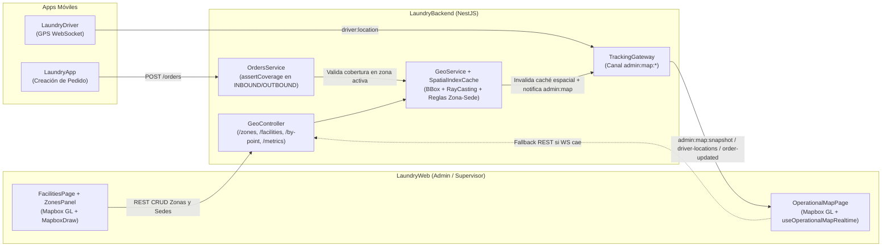

# Plan de Revisión y Alineación: Zonas, Sedes y Mapa Operativo en Laundry

> **Objetivo:** Auditar y alinear la lógica de **Zonas**, **Sedes** y **Mapa Operativo** en **Laundry Clean & Fresh** (`LaundryBackend` + `LaundryWeb`) para que cumpla el mismo estándar limpio, espacial, en tiempo real y con **Mapbox + WebSockets** ya probado en **AnubisRide**, preservando y fortaleciendo el agregado propio de Laundry (**gestión de Sedes / Plantas de lavado vinculadas a Zonas**).

---

## 1. Diagnóstico Comparativo: AnubisRide vs. Estado Actual en Laundry

| Capacidad | Referencia funcional en AnubisRide | Estado actual en Laundry | Brecha / Acción requerida |
| :--- | :--- | :--- | :--- |
| **Motor de mapas Web** | `mapbox-gl` + `@mapbox/mapbox-gl-draw` (`ZoneMapView.tsx`, `ZoneDrawMapModal.tsx`) | `leaflet` (`BaseMap.tsx`) con dibujo manual por clics, aunque `LaundryWeb/.env` ya tiene `VITE_MAPBOX_PUBLIC_TOKEN` | Migrar Mapa Operativo y Editor de Zonas/Sedes en `LaundryWeb` a **Mapbox GL JS + MapboxDraw** (`streets-v12`). |
| **Algoritmo espacial e índice en Backend** | Bounding Box `O(1)` + Ray-Casting + caché en memoria (`ActiveZonesSpatialIndexProvider`, TTL 60s + invalidación por generación) | `pointInPolygon` directo en `GeoService` consultando `prisma.zone.findMany()` en cada `resolveZone` | Agregar **Bounding Box pre-check**, **validación de geometría** y **caché espacial en memoria con invalidación inmediata** en `LaundryBackend/src/geo`. |
| **Integridad Zona ↔ Sede en Backend** | N/A (solo Zonas) | `GeoService.createFacility` / `updateFacility` / `updateZone` **NO** validan en servidor que la sede caiga dentro del polígono ni que editar el polígono deje sedes fuera (solo se valida en frontend) | Portar las reglas geométricas de `zone.rules.ts` al **servidor (`GeoService`)** como fuente única de verdad. |
| **Endpoints operativos y métricas** | `POST /zones/by-point`, `GET /zones/metrics/summary`, `GET /zones/:id/drivers`, `GET /zones/active/online-drivers`, `GET /zones/active/requested-trips` | Solo CRUD básico (`GET/POST/PATCH /zones` y `/facilities`) | Añadir endpoints de consulta por punto, métricas por zona y snapshot operativo (choferes online + pedidos activos + sedes). |
| **Tiempo real (WebSockets Admin)** | `SocketGateway` con canal `admin:map:subscribe`, `admin:map:snapshot`, `admin:map:driver-locations` (throttled/batch), `admin:map:driver-offline`, `admin:map:trip-*` + `useZoneMapRealtime.ts` | `TrackingGateway` solo cubre cliente/chofer (`order:<id>`). `OperationalMapPage.tsx` usa datos locales/simulados (*"Movimiento de choferes simulado"*) | Extender `TrackingGateway` con canal `admin:map:*` (para `ADMIN` y `SUPERVISOR`) y conectar `OperationalMapPage.tsx` vía `socket.io-client` con respaldo REST. |
| **Persistencia Frontend (`Sedes` y `Zonas`)** | `HttpZoneRepository.ts` directo al backend | Mezcla `localStorage` (`LocalZoneRepository.ts`, `ZONES_KEY`) con `geoApi.ts` | Eliminar dependencia de `localStorage` como estado fuente; usar API REST como fuente única de verdad. |
| **Navegación desde pines del Mapa Operativo** | Usa tipo de marcador + ID real | `OperationalMapPage.tsx` usa prefijos mock (`SOL-`, `FAC-`, `DRV-`) que fallan con UUIDs reales | Navegar según `point.kind` (`pickup`/`delivery` → orden, `facility` → sedes, `driver` → choferes, `incident` → incidencias). |

---

## 2. Arquitectura Objetivo (Flujo Completo)

---

## 3. Plan Detallado por Fases

### Fase 1 — Backend Espacial, Caché e Integridad Zona ↔ Sede (`LaundryBackend`)

**Archivos objetivo:**
- `src/geo/geo-spatial.util.ts` *(nuevo — portado de `uber-backend/src/modules/zones/domain/zones-spatial.util.ts`)*
- `src/geo/active-zones-spatial-index.provider.ts` *(nuevo — portado de `ActiveZonesSpatialIndexProvider`)*
- `src/geo/geo.service.ts` *(actualizar)*
- `src/geo/geo.controller.ts` *(actualizar)*
- `src/geo/geo.module.ts` *(actualizar)*
- `src/orders/orders.service.ts` *(verificar uso consistente)*

**Checklist de revisión e implementación:**
1. **Utilidades espaciales y validación geométrica (`geo-spatial.util.ts`):**
   - Implementar `boundingBoxFromRing`, `isPointInBoundingBox`, `isPointInPolygonRing` (Ray-Casting) y `buildZoneSpatialIndex`.
   - Validar al crear/actualizar zona que el polígono tenga `>= 3` vértices únicos, coordenadas finitas válidas (`lat ∈ [-90, 90]`, `lng ∈ [-180, 180]`), área positiva y **sin auto-intersecciones**.
2. **Índice espacial en memoria (`ActiveZonesSpatialIndexProvider`):**
   - Cachear zonas activas en RAM con TTL de 60 s y contador `generation` para evitar condiciones de carrera.
   - Llamar `spatialIndex.invalidate()` en toda escritura (`createZone`, `updateZone`).
   - Refactorizar `GeoService.resolveZone(point)` para consultar el índice espacial (BBox `O(1)` → Ray-Casting) en lugar de hacer `findMany()` a PostgreSQL en cada llamada.
3. **Reglas de negocio del agregado Sedes en servidor (`GeoService`):**
   - En `createFacility` y `updateFacility`: validar con `isPointInPolygon` que `(latitude, longitude)` **esté dentro del polígono de `zoneId`** (lanzar `UnprocessableEntityException` / `BadRequestException` si cae fuera).
   - En `updateZone`:
     - Si cambia `polygon`, verificar que **todas las sedes vinculadas** a esa zona sigan cayendo dentro del nuevo polígono; si alguna queda fuera, rechazar con `ConflictException`.
     - Si cambia `polygon` o `active: false`, verificar que no existan **pedidos en curso** (`status NOT IN ('COMPLETED', 'CANCELLED')`) en las sedes de esa zona (o mantener coherencia con `assertZoneHasNoActiveFacilities`).
4. **Nuevos endpoints operativos en `GeoController`:**
   - `POST /zones/by-point` (`{ lat, lng }`): devuelve la zona activa (y sus sedes activas) que cubre el punto, o `404` si está fuera de cobertura.
   - `GET /zones/metrics/summary` (`ADMIN`, `SUPERVISOR`): métricas por zona (sedes activas, choferes disponibles/en servicio, pedidos activos de recogida/entrega).
   - `GET /zones/operational-snapshot` (`ADMIN`, `SUPERVISOR`): snapshot REST unificado de zonas activas, sedes, choferes online con última ubicación GPS y pedidos en curso (respaldo del Mapa Operativo).
5. **Verificación en `OrdersService`:**
   - Confirmar que al crear o reprogramar un pedido (`INBOUND` y `OUTBOUND` si es `HOME_HOME`), la dirección del cliente se valide contra el polígono vigente de la zona de la sede (`assertCoverage`), y que la sede y su zona estén activas.

---

### Fase 2 — WebSockets en Tiempo Real para el Mapa Operativo (`LaundryBackend`)

**Archivos objetivo:**
- `src/tracking/tracking.gateway.ts` *(extender)*
- `src/tracking/tracking.constants.ts` *(añadir eventos `admin:map:*`)*
- `src/drivers/drivers.service.ts` *(notificar cambio de estado/ubicación al canal admin)*
- `src/orders/orders.service.ts` *(notificar creación/cambio de estado de pedido al canal admin)*

**Checklist de revisión e implementación:**
1. **Room y autenticación de personal (`admin:map`):**
   - Al autenticar un socket con rol `ADMIN` o `SUPERVISOR`, permitir `@SubscribeMessage('admin:map:subscribe')` (rechazar otros roles con `admin:map:error`).
   - Unir al socket al room `admin:map` (para `SUPERVISOR`, opcionalmente filtrar por su `facilityId` si aplica).
2. **Snapshot inicial (`admin:map:snapshot`):**
   - Al suscribirse, emitir inmediatamente el estado real actual:
     - `drivers`: choferes activos (`AVAILABLE`, `ON_SERVICE`, `BREAK`) con `driverId`, `name`, `status`, `facilityId`, `zoneIds`, `lat`, `lng`, `heading`, `speed`, `locationAt`.
     - `orders`: pedidos en etapas operativas de mapa (`PICKUP_PENDING`..`ARRIVED_FOR_PICKUP`, `DELIVERY_ASSIGNED`..`ARRIVED_FOR_DELIVERY`) con coordenadas de cliente y estado.
     - `incidents`: incidencias abiertas vinculadas a pedidos activos.
3. **Emisiones incrementales con throttle (patrón Anubis):**
   - `admin:map:driver-locations`: throttle por chofer (p. ej. cada 2–3 s) al recibir `driver:location` o `PATCH /drivers/me/location`, evitando saturar el navegador.
   - `admin:map:driver-offline`: emitir cuando un chofer se desconecta o pasa a `OFFLINE`.
   - `admin:map:order-updated`: emitir cuando un pedido se crea o cambia de estado (para actualizar/retirar pines de recogida/entrega en el mapa sin recargar).

---

### Fase 3 — Configuración de Mapbox GL JS + MapboxDraw en `LaundryWeb`

**Archivos objetivo:**
- `LaundryWeb/package.json` *(instalar `mapbox-gl`, `@mapbox/mapbox-gl-draw`, `socket.io-client` y tipos)*
- `LaundryWeb/src/config/mapbox.ts` *(nuevo — equivalente a `uber-web/src/config/mapbox.ts`, leyendo `VITE_MAPBOX_PUBLIC_TOKEN` y `VITE_MAPBOX_STYLE`)*
- `LaundryWeb/src/config/mapboxMapRuntime.ts` *(nuevo — portado de Anubis para suprimir capas 404 como `mapbox-traffic-v1` y manejar errores de estilo)*
- `LaundryWeb/src/components/maps/mapboxGeo.ts` *(nuevo — conversión limpia entre GeoJSON `[lng, lat]` y `{ lat, lng }`, cálculo de bounds/centro)*

**Checklist de revisión e implementación:**
1. Instalar dependencias en `LaundryWeb`: `mapbox-gl`, `@mapbox/mapbox-gl-draw`, `socket.io-client` (y `@types/mapbox-gl` si aplica).
2. Configurar estilo claro por defecto (`mapbox://styles/mapbox/streets-v12`) y fallback limpio si falta el token (`MapboxTokenMissing`).
3. Reutilizar `configureMapboxMap(map)` de Anubis para evitar errores 404 en consola por fuentes no habilitadas.
4. Asegurar que todos los mapas en `LaundryWeb` respondan a `ResizeObserver` (`map.resize()`) dentro de modales, drawers y layouts responsivos.

---

### Fase 4 — Apartado **Sedes** (`FacilitiesPage.tsx` + `ZonesPanel.tsx`)

**Archivos objetivo:**
- `LaundryWeb/src/features/logistics/FacilitiesPage.tsx`
- `LaundryWeb/src/features/logistics/zones/ZonesPanel.tsx`
- `LaundryWeb/src/features/logistics/zones/ZoneEditor.tsx` *(migrar a `MapboxDraw`: `draw_polygon`, `direct_select`, `trash`)*
- `LaundryWeb/src/features/logistics/zones/FacilityLocationPicker.tsx` y `FacilityPinPreview.tsx` *(migrar a Mapbox GL JS)*
- `LaundryWeb/src/features/logistics/zones/useZones.ts` *(fuente única de verdad HTTP, sin estado fantasma en `localStorage`)*
- `LaundryWeb/src/services/api/geoApi.ts` *(añadir `findZoneByPoint`, `getZonesMetricsSummary`)*

**Checklist de revisión e implementación:**
1. **Dibujo y edición de Zonas con MapboxDraw:**
   - Al crear zona: abrir modal con `MapboxDraw` en modo `draw_polygon` (con botón de cancelar/borrar, validación de `>= 3` vértices y auto-cierre).
   - Al editar zona: cargar el polígono existente en `MapboxDraw` en modo `direct_select` (edición directa de vértices) y ajustar la cámara con `fitBounds`.
   - Mostrar las demás zonas existentes y los pines de **Sedes** como referencia visual en el mapa mientras se edita, impidiendo visual y lógicamente dejar una sede fuera de su zona.
2. **Registro y edición de Sedes (agregado de Laundry):**
   - Seleccionar zona → colocar/arrastrar pin de sede sobre el mapa Mapbox GL JS con el polígono de la zona resaltado.
   - Validar en tiempo real con `zoneContains` (y en el servidor al guardar) que el pin esté dentro de la zona activa.
   - Integrar búsqueda de dirección y geocodificación inversa (`MapboxGeoProvider`) para autocompletar dirección y ciudad al colocar el pin.
   - Validar capacidad diaria (`>= 1 kg`), horarios de apertura/cierre, días operativos y estado (`ACTIVE` / `MAINTENANCE`), mostrando mensajes claros del backend si hay pedidos abiertos al intentar desactivar.
3. **Visualización de Zonas + Sedes en `ZonesPanel`:**
   - Renderizar capas GeoJSON (`zones-source`) con relleno/borde diferenciado para zonas activas vs. inactivas y zona seleccionada.
   - Popups interactivos al hacer clic en una zona o sede (nombre, estado, sedes vinculadas, capacidad total, métricas).
   - Eliminar el guardado/lectura silenciosa desde `localStorage` (`LocalZoneRepository`) para que recargar la página refleje siempre los datos reales de PostgreSQL.

---

### Fase 5 — Apartado **Mapa Operativo** (`OperationalMapPage.tsx`)

**Archivos objetivo:**
- `LaundryWeb/src/services/realtime/adminSocketService.ts` *(nuevo — cliente Socket.IO con JWT de `session.getToken()`)*
- `LaundryWeb/src/hooks/useOperationalMapRealtime.ts` *(nuevo — equivalente a `useZoneMapRealtime.ts` de Anubis)*
- `LaundryWeb/src/features/logistics/OperationalMapPage.tsx` *(refactorizar a Mapbox GL JS + tiempo real)*
- `LaundryWeb/src/components/maps/OperationalMapboxView.tsx` *(nuevo — equivalente a `ZoneMapView.tsx` adaptado a Laundry)*
- `LaundryWeb/src/features/logistics/zones/zonePopupHtml.ts` *(nuevo — popups seguros/sanitizados para zonas, sedes, choferes y pedidos)*

**Checklist de revisión e implementación:**
1. **Conectar a datos reales en tiempo real (cero simulación):**
   - Remover el subtítulo *"Escenario local de Samborondón. Movimiento de choferes simulado."* y el consumo de choferes simulados.
   - Suscribirse a `admin:map:subscribe` al montar `OperationalMapPage` y actualizar marcadores de choferes y pedidos al instante vía `admin:map:driver-locations`, `admin:map:driver-offline` y `admin:map:order-updated`.
   - Mantener polling de respaldo REST (`/zones/operational-snapshot`) solo con intervalo largo cuando el socket está conectado (120 s) y backoff exponencial si el socket se desconecta (patrón `ZoneMapView.tsx` de Anubis).
2. **Capas y controles operativos en Mapbox GL JS:**
   - **Zonas:** Polígonos GeoJSON activables/filtrables por zona, con popup de métricas (`sedes`, `choferes disponibles`, `pedidos activos`).
   - **Sedes:** Marcadores diferenciados por estado (`Operativa` vs `Mantenimiento`) con popup de carga actual / capacidad kg/día.
   - **Choferes:** Marcadores dinámicos por estado (`AVAILABLE`, `ON_SERVICE`, `BREAK`, `OFFLINE`), indicador de señal GPS desactualizada (`stale`), rotación opcional por `heading` y modo **"Seguir chofer"** (`easeTo` suave al centro del chofer seleccionado).
   - **Pedidos e Incidencias:** Pines diferenciados para Recogidas activas (`pickup`), Entregas activas (`delivery`) e Incidencias abiertas (`incident`).
3. **Corrección de navegación al hacer clic en pines/tabla:**
   - Reemplazar `id.startsWith('SOL-') / 'FAC-' / 'DRV-'` por dispatch según `point.kind`, usando el UUID real del recurso.

---

## 4. Plan de Verificación (Pruebas Automatizadas y E2E)

### Backend (`LaundryBackend`)
- **Pruebas unitarias (`test/unit/geo-zones.test.ts`):**
  - `isPointInBoundingBox` y `isPointInPolygonRing` (dentro, fuera, borde, polígonos cóncavos, coordenadas inválidas).
  - Validación de polígonos malformados o auto-intersecados.
  - `ActiveZonesSpatialIndexProvider`: hit de caché, invalidación por generación al crear/actualizar zona.
  - Reglas Zona ↔ Sede: rechazar sede fuera del polígono de su zona; rechazar edición de polígono que deje una sede activa fuera; rechazar desactivación de zona con sedes activas.
- **Pruebas de WebSocket (`test/unit/tracking.test.ts`):**
  - `admin:map:subscribe` permitido para `ADMIN`/`SUPERVISOR` y rechazado para `CLIENT`/`DRIVER`.
  - Emisión throttled de `admin:map:driver-locations` y limpieza con `admin:map:driver-offline`.
- **Comandos:** `pnpm typecheck && pnpm build && pnpm test`.

### Frontend Web (`LaundryWeb`)
- **Pruebas unitarias y de contratos:**
  - Conversión `mapboxGeo` (`GeoJSON Polygon` ↔ `LatLng[]` del backend).
  - Mappers de eventos `admin:map:*` → estado del mapa.
  - Sanitización HTML de popups (`zonePopupHtml`).
- **Prueba funcional end-to-end en navegador (`localhost:3000`):**
  1. **Sedes → Crear zona** en MapboxDraw → verificar persistencia en PostgreSQL tras recargar (`F5`).
  2. **Sedes → Registrar sede** intentando colocar el pin fuera de la zona (debe bloquear en UI y API) y luego dentro de la zona (debe guardar y aparecer en la tarjeta y en el mapa).
  3. **Sedes → Editar polígono de zona** intentando dejar la sede fuera (debe rechazar) y ampliando la zona (debe guardar e invalidar caché espacial).
  4. **Mapa Operativo** → verificar carga de zonas, sedes y choferes reales; mover ubicación desde `LaundryDriver` y confirmar que el marcador del chofer se desplaza en vivo en `OperationalMapPage` sin recargar la página; probar filtros por zona, capas y botón *"Seguir chofer"*.
- **Comandos:** `pnpm lint && pnpm build && pnpm test`.

---

## 5. Restricciones y Criterios de Calidad
- **Sin cambios destructivos de esquema Prisma** salvo autorización explícita (el modelo actual `Zone`, `Facility`, `DriverZone` en `schema.prisma` ya soporta todo el flujo).
- **Sin emojis en la interfaz** (usar íconos de `lucide-react`).
- **Servidor como única fuente de verdad** (sin datos simulados ni fallback silencioso a `localStorage` en escrituras).
- **Modo claro limpio (`streets-v12`)** consistente en todo el panel web.
